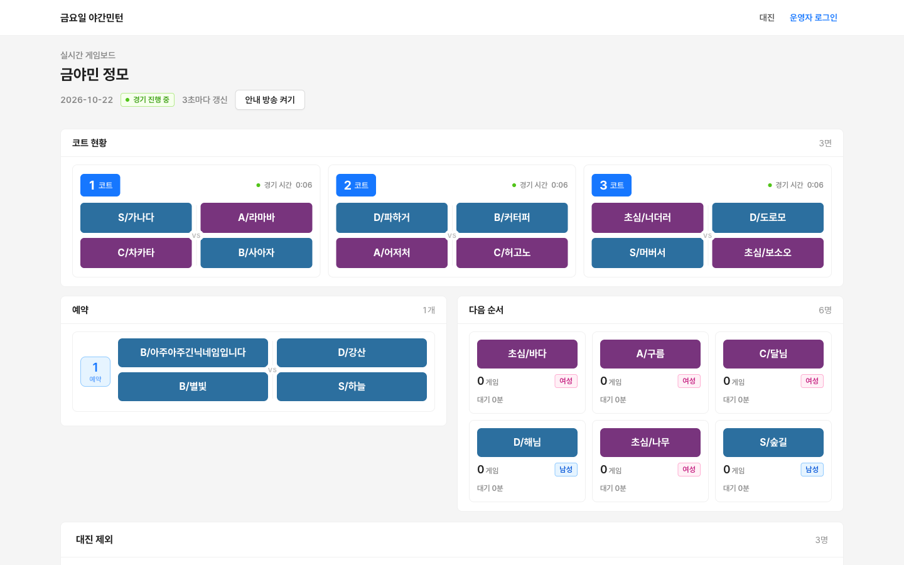
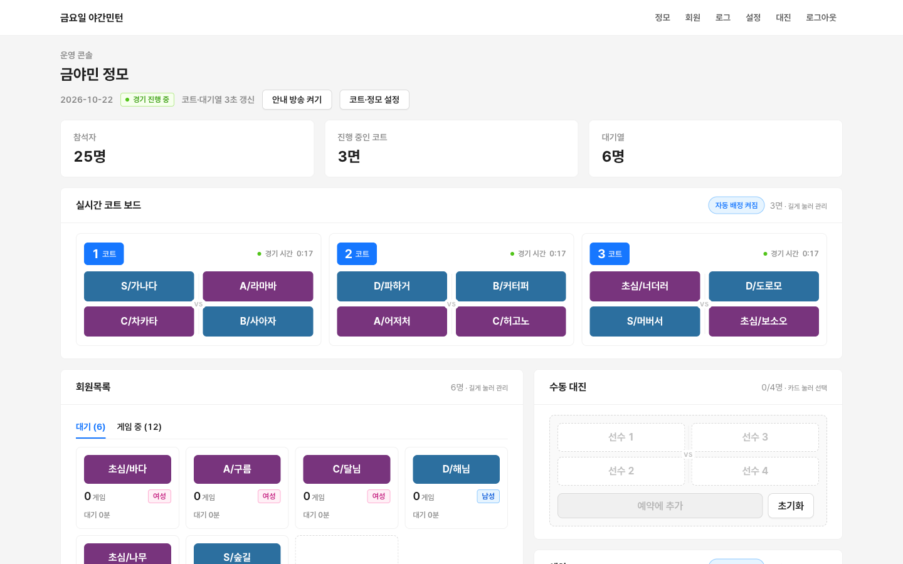
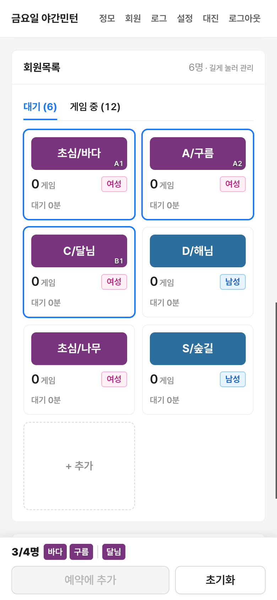

# 🏸 배드민턴 매칭 badmintonMatch

<h3 align="center">정모 현장의 대진, 코트, 대기 순서를 한 화면에서</h3>

<p align="center">
  소모임 정모 참석자를 불러와 급수와 성별로 복식 대진을 자동으로 짜고,<br>
  코트 배정과 다음 순서를 휴대폰과 체육관 화면에 실시간으로 보여 주는<br>
  <strong>배드민턴 정모 운영 웹앱</strong>
</p>

<p align="center">
  <strong>Python · Flask · Jinja · SQLite · Vanilla JS · Gunicorn · Docker · Cloudflare Tunnel · Supertonic TTS</strong>
</p>

> 운영 주소: <https://badminton.jmllem.com> (대진판은 누구나, 운영 콘솔은 운영진 비밀번호로 접속)
> 첫 실제 정모는 2026-10-23 "금요일 야간민턴"이며, 이 저장소의 `main`이 곧 운영 버전입니다.

---

## 📑 목차

1. [사용자 경험](#user-experience)
2. [핵심 기술 문제와 해결](#technical-solutions)
3. [시스템 아키텍처](#system-architecture)
4. [구현 및 배포 범위](#implementation-and-deployment)
5. [테스트 및 품질 관리](#quality-assurance)
6. [기술 스택](#tech-stack)
7. [프로젝트 구조](#project-structure)
8. [실행 방법](#getting-started)
9. [주요 화면과 라우트](#main-routes)
10. [협업 방식](#collaboration)

<br>

<a id="user-experience"></a>

## ✨ 사용자 경험

<p align="center">
  
</p>

### 1. 정모 불러오기

- 소모임 모임 링크를 등록하고 날짜를 고르면 그날 정모와 참석자를 불러옵니다.
- 소모임을 읽지 못하면 참석자 닉네임 붙여넣기나 정모 직접 추가로 대신합니다.
- 다시 불러오면 새 신청자는 추가하고, 소모임에서 취소한 사람은 화면에서 뺍니다.
- 회원목록의 "+ 추가"로 신청 없이 온 회원, 처음 온 회원, 게스트를 바로 넣습니다.

### 2. 자동 대진과 예약

- "코트 시작"을 누르면 빈 코트에 급수가 비슷한 4명을 골라 바로 경기를 넣습니다.
- 대기가 8명 이상이면 코트 수만큼 다음 경기를 예약으로 미리 묶어 둡니다.
- 경기가 끝난 코트는 15초 교대 시간 뒤에 다음 예약이나 대기열로 채웁니다.
- 자동 예약과 자동 배정은 각각 버튼으로 끌 수 있습니다.
- 대기 시간은 코트 시작을 누른 때부터 셉니다.

### 3. 운영 콘솔

<p align="center">
  
  
</p>

- 회원목록 카드를 눌러 4명을 고르면 수동 대진으로 예약을 만듭니다. 휴대폰에서는 화면 아래 선택 바에서 바로 예약합니다.
- 카드를 길게 누르면 상태(대기 복귀·지각·휴식·퇴장), 성별·급수, 메모, 이름을 고칩니다.
- 코트 카드를 길게 누르면 경기 중인 코트는 게임 끝내기·호출, 빈 코트는 게임·빈코트·레슨 상태를 바꿉니다.
- 예약은 수정, 우선 넣기, 바로 넣기, 다시 뽑기, 삭제를 할 수 있습니다.
- 모든 운영 작업은 운영 로그에 남고 기간·작업·정모로 검색합니다.
- 정모가 끝나면 설정의 "정모 끝"으로 진행 중인 경기를 마치고 대진판에서 내립니다.

### 4. 공개 대진판과 안내 방송

- 선수들은 로그인 없이 대진판에서 코트, 예약, 다음 순서를 봅니다. 3초마다 바뀐 부분만 갱신합니다.
- 넓은 화면에서는 코트를 한 줄에 4개까지 놓고, 예약과 다음 순서를 나란히 보여 줍니다.
- "안내 방송 켜기"를 누르면 새 경기가 코트에 들어갈 때 "1코트, 누구, 누구 님 들어가세요"를 읽어 줍니다.

<br>

<a id="technical-solutions"></a>

## 🧩 핵심 기술 문제와 해결

### 공정한 순서와 비슷한 실력을 함께 맞춥니다

대기열은 경기 수가 적은 사람, 그다음 오래 기다린 사람 순입니다. 맨 앞 사람은 반드시
다음 경기에 들어가고, 나머지 3명은 앞쪽 후보 안에서 급수 차이가 가장 작은 조합으로 고릅니다.

```text
대기열 정렬: 경기 수 → 대기 시작 시각 → 등록 순
후보: 앞쪽 6명(MIX_WINDOW) + 같은 경기 수 그룹 (성비가 안 맞을 때만 전체로 넓힘)
조합 고르기: 혼복 목표 비율에 따라 남복·여복 또는 혼복 우선 → (급수 폭 + 직전 짝 겹침 × 2) 최소 → 대기 순서 앞쪽
팀 나누기: 급수 점수 S6 A5 B4 C3 D2 초심1, 여자는 보정값만큼 빼고 두 팀 합이 가장 가깝게
```

혼복은 남녀가 한 팀씩 섞이도록만 나누고, 다시 뽑기 직전의 4명과 똑같은 조합은
다른 조합이 있으면 고르지 않습니다. 여자 보정값과 혼복 비율(%)은 설정 화면에서 바꿉니다.

### 같은 사람끼리 연달아 묶이지 않게 합니다

직전 경기에서 같이 친 사람을 기억해 두고, 다시 같은 조에 묶이는 쌍마다 벌점을 줍니다.
운영진이 다시 뽑은 경기는 취소로 표시해 이 기록에서 뺍니다.

### 코트 상태와 스위치를 지키며 빈 코트를 채웁니다

```text
경기 끝 → 15초 교대 시간 → 빈 코트 채우기
  1. 앞 예약 중 게임 중인 선수가 없는 예약
  2. 예약이 없으면 대기열에서 4명
레슨·빈코트 상태 코트와 자동 배정이 꺼진 동안은 건너뜀
자동 예약 목표 개수 = "게임" 상태 코트 수
```

### 화면을 통째로 바꾸지 않고 바뀐 곳만 고칩니다

3초마다 코트·예약·대기열·대진 제외 영역의 HTML만 JSON으로 받아, 같은 `data-key`를 가진
카드는 같은 요소로 보고 글자와 속성만 고칩니다. 그래서 누르던 버튼이 끊기거나 스크롤이
튀지 않습니다. 팝업이 열려 있거나 수동 대진을 고르는 중에는 갱신을 멈추고, 두 번 연속
실패하면 "연결 끊김 · 마지막 갱신 시각"을 빨갛게 표시합니다.

### 소모임 공개 페이지만 읽습니다

소모임은 공개 API가 없어 로그인 없이 받는 모임 페이지의 Next.js 스트리밍 데이터를
파싱합니다. 페이지 구조가 바뀌면 `SomoimError`로 알리고 붙여넣기로 대신합니다. 개인정보는
닉네임과 운영에 필요한 급수·성별만 저장하고, 소개 글 원문은 저장하지 않습니다.

### 작은 서버에서 안전하게 동시에 씁니다

Gunicorn 프로세스 1개와 스레드 4개로 돌고, DB를 쓰는 요청은 앱 잠금(`serial_lock`)으로
한 번에 하나씩 처리합니다. SQLite는 자동 커밋 모드에서 `transaction()`으로 묶어 원자적으로
씁니다. 안내 방송 음성 합성만 잠금 밖에서 따로 돌아 화면 갱신을 막지 않습니다.

<br>

<a id="system-architecture"></a>

## 🏗️ 시스템 아키텍처

```text
운영진 휴대폰 / 체육관 TV / 선수 휴대폰 (브라우저)
↔ Cloudflare Tunnel (badminton.jmllem.com)
↔ 홈 서버 Docker 컨테이너
   └ Gunicorn (1 프로세스 · 4 스레드)
      └ Flask 앱 (badminton.create_app)
         ├ admin  : 운영 콘솔 (비밀번호 로그인, Origin 검사)
         ├ public : 대진판, 안내 방송 MP3
         ├ meetups / matching : 대진·예약·코트 로직
         └ SQLite (/data/badminton.db, 볼륨으로 보존)

Flask
→ 소모임 웹 모임 페이지 (참석자 읽기, 실패하면 붙여넣기)
→ Supertonic 3 (한국어 TTS, 이미지에 모델 포함, CPU ONNX)
```

<br>

<a id="implementation-and-deployment"></a>

## 🚀 구현 및 배포 범위

| 영역 | 구현 내용 |
|---|---|
| 정모 | 소모임 불러오기·다시 불러오기, 붙여넣기, 직접 추가, 보관·복구, 정모 끝 |
| 참석자 | 회원·게스트 추가, 상태(지각·휴식·퇴장), 성별·급수·메모·이름 수정, 취소자 숨김 |
| 대진 | 자동 배정, 자동 예약, 수동 대진, 예약 수정·우선·바로 넣기·다시 뽑기·삭제 |
| 코트 | 코트 수 변경, 게임·빈코트·레슨 상태, 15초 교대 시간, 자동 배정 ON/OFF |
| 화면 | 운영 콘솔, 공개 대진판, 3초 부분 갱신, 연결 끊김 표시, 길게 누르기 팝업 |
| 안내 방송 | 새 경기 코트 호출 음성(Supertonic), 다시 호출 |
| 운영 | 운영 로그(검색·페이지), 설정(여자 보정값·혼복 비율), 모임 여러 개 |
| 보안 | 운영진 비밀번호, 로그인 실패 제한(15분에 5회), Origin/Referer 검사, SameSite 쿠키 |

### 배포 흐름

```text
main 반영 (pytest 전체 통과)
→ 운영 DB 백업 (data/badminton.db.bak-<시각>)
→ 앱 파일 rsync (data·.env 제외)
→ scripts/deploy.sh: 현재 이미지를 badminton:previous로 보존 → badminton:current 빌드 → 컨테이너 교체
→ 운영 주소에서 로그인·화면 확인
```

롤백은 `badminton:previous`를 `current`로 다시 태그하고 빌드 없이 컨테이너를 올립니다.
자세한 명령은 [`docs/deployment.md`](docs/deployment.md)에 있습니다. DB 스키마 변경은 앱이 시작할 때
`db.connect()`가 없는 표와 열만 더하는 방식이라 기존 데이터를 그대로 둡니다.

<br>

<a id="quality-assurance"></a>

## ✅ 테스트 및 품질 관리

pytest 224개가 매칭 규칙부터 화면 마크업까지 검사합니다. 모든 변경은 전체 테스트를 통과한 뒤에만
`main`에 들어가고, 화면 변경은 휴대폰(390px)과 PC(1440px) 폭에서 실제 브라우저로 확인합니다.

| 파일 | 검증 범위 |
|---|---|
| `test_matching.py` | 대기열 정렬, 4명 고르기, 혼복 팀 나누기, 직전 짝 벌점 |
| `test_meetups.py` | 코트 채우기, 예약, 교대 시간, 코트 상태, 자동 예약·배정 스위치, 정모 끝, 대기 시간 기준 |
| `test_admin.py` | 운영 콘솔 라우트, 권한, 운영 로그, 화면 마크업·접근성 |
| `test_public.py` | 대진판, 부분 갱신 응답, 공개 화면에 운영 기능이 없는지 |
| `test_somoim.py` | 소모임 페이지 파싱과 실패 처리 |
| `test_members.py` · `test_groups.py` | 회원 정보 변경 기록, 모임 등록 |
| `test_announce.py` | 안내 방송 문구와 음성 응답 |
| `test_simulate.py` | 정모 시뮬레이터 |

### 로컬 검증 명령

```bash
.venv/bin/pytest -q

# 실제 DB 사본으로 대기 시간·경기 균형 시뮬레이션 (원본 DB는 바꾸지 않음)
python scripts/simulate_meetup.py <db파일> --meetup 1 --courts 3 --minutes 180 --seed 42
```

시뮬레이터 사용법은 [`docs/simulator.md`](docs/simulator.md)에 있습니다.

<br>

<a id="tech-stack"></a>

## 🛠️ 기술 스택

| 구분 | 기술 | 사용 목적 |
|---|---|---|
| Backend | Python 3.12, Flask 3.1 | 라우트, 세션, Jinja 템플릿 렌더링 |
| Frontend | Jinja, Vanilla JS, CSS | 서버 렌더링 화면, 부분 갱신, 길게 누르기 팝업 |
| Design | Ant Design 5 토큰 | 색·모서리·글자 크기 기준 |
| Persistence | SQLite | 정모·참석자·경기·예약·운영 로그 저장 |
| Server | Gunicorn | 1 프로세스 · 4 스레드 WSGI 서버 |
| TTS | Supertonic 3 | 한국어 코트 호출 안내 방송 |
| Infra | Docker Compose, Cloudflare Tunnel | 홈 서버 배포와 외부 공개 |
| Test | pytest | 단위·라우트·마크업 테스트 |

<br>

<a id="project-structure"></a>

## 🗂️ 프로젝트 구조

```text
badmintonMatch/
├── badminton/
│   ├── __init__.py          # create_app, 설정, 요청 잠금
│   ├── db.py                # 스키마, 마이그레이션, 설정 값, transaction()
│   ├── matching.py          # 대기열 정렬, 4명 고르기, 팀 나누기
│   ├── meetups/             # 정모 도메인 로직 (`from badminton.meetups import X`는 그대로)
│   │   ├── common.py        # 상수, 보관 오류, today, 여러 곳이 쓰는 작은 조회
│   │   ├── scheduling.py    # 코트·예약·경기 (빈 코트 채우기, 예약, 게임 끝내기·다시 뽑기, 코트 상태)
│   │   ├── attendance.py    # 참석자 (참석 추가, 소모임 동기화, 상태·메모, 수동 대진 후보)
│   │   ├── lifecycle.py     # 정모 만들기·보관·복구, 코트 시작, 정모 끝
│   │   └── board.py         # 대진판과 화면에 보여 줄 값
│   ├── members.py           # 회원, 성별·급수 변경 기록
│   ├── groups.py            # 소모임 모임 등록
│   ├── somoim.py            # 소모임 페이지 파싱
│   ├── announce.py          # 안내 방송 문구와 음성 합성
│   ├── audit.py             # 운영 로그
│   ├── admin/               # 운영 콘솔 라우트 (블루프린트 admin)
│   │   ├── __init__.py      # bp, 로그인 제한, Origin 검사, 공용 도우미
│   │   ├── routes_meetups.py   # 정모 목록·불러오기, 운영 콘솔 화면, 코트 시작·정모 끝·코트 상태
│   │   ├── routes_play.py      # 참석자 상태·정보, 게스트·회원 추가, 수동 대진, 게임·예약 관리
│   │   ├── routes_settings.py  # 설정, 자동 예약·자동 배정 스위치
│   │   └── routes_people.py    # 회원, 모임, 운영 로그
│   ├── public.py            # 대진판·안내 방송 라우트
│   └── templates/           # base.html(공통 CSS·JS), 화면·부분 템플릿
├── tests/                   # pytest
├── scripts/
│   ├── deploy.sh            # 이미지 보존·빌드·교체
│   └── simulate_meetup.py   # 정모 시뮬레이터
├── docs/
│   ├── deployment.md
│   ├── simulator.md
│   └── images/              # README 화면 (테스트용 가짜 이름)
├── Dockerfile
├── docker-compose.yml
├── requirements.txt
└── requirements-dev.txt
```

<br>

<a id="getting-started"></a>

## ▶️ 실행 방법

### 로컬

```bash
python3.12 -m venv .venv
.venv/bin/pip install -r requirements-dev.txt

export ADMIN_PASSWORD=<운영진 비밀번호>
export SECRET_KEY=<임의의 긴 문자열>
export DATABASE=./data/dev.db
export SESSION_COOKIE_SECURE=0   # 로컬 http에서만

.venv/bin/flask --app "badminton:create_app()" run --port 5000
```

`ADMIN_PASSWORD`나 `SECRET_KEY`가 비어 있으면 앱이 시작하지 않습니다. 안내 방송은 처음 호출될 때
Supertonic 모델(약 400MB)을 받아 메모리에 올립니다.

### Docker

`.env`에 아래 환경변수를 적은 뒤 실행합니다. `docker-compose.yml`은 홈 서버의 외부 네트워크
(`server-edge_default`)에 붙도록 되어 있으니, 다른 환경에서는 `networks` 항목을 맞게 바꿉니다.

```bash
docker compose up -d --build
```

### 주요 환경변수

| 이름 | 설명 |
|---|---|
| `ADMIN_PASSWORD` | 운영 콘솔 비밀번호 (필수) |
| `SECRET_KEY` | 세션 서명 키 (필수) |
| `DATABASE` | SQLite 파일 경로 (기본 `/data/badminton.db`) |
| `SOMOIM_GROUP_ID` | 처음 등록할 기본 소모임 모임 ID |
| `SESSION_COOKIE_SECURE` | `1`(기본)이면 HTTPS에서만 쿠키 전송, 로컬 http는 `0` |

<br>

<a id="main-routes"></a>

## 🔌 주요 화면과 라우트

| 구분 | 경로 | 설명 |
|---|---|---|
| 공개 | `GET /board`, `GET /board/updates` | 대진판과 3초 부분 갱신 |
| 공개 | `GET /announce/<game_id>.mp3` | 코트 호출 음성 |
| 운영 | `GET /admin`, `POST /admin/import`, `POST /admin/meetups` | 정모 목록, 소모임 불러오기, 직접 추가 |
| 운영 | `GET /admin/m/<mid>`, `GET /admin/m/<mid>/updates` | 운영 콘솔과 부분 갱신 |
| 운영 | `POST /admin/m/<mid>/start`, `/end`, `/auto-match` | 코트 시작·코트 수 변경, 정모 끝, 빈 코트 자동 매칭 |
| 운영 | `POST /admin/m/<mid>/court/<n>/state` | 코트 상태(게임·빈코트·레슨) |
| 운영 | `POST /admin/m/<mid>/member`, `/guest` | 회원·게스트 참석 추가 |
| 운영 | `POST /admin/m/<mid>/status`, `/info`, `/memo`, `/rename` | 참석자 상태와 정보 |
| 운영 | `POST /admin/m/<mid>/manual` | 수동 대진으로 예약 만들기 |
| 운영 | `POST /admin/game/<gid>/end`, `/redraw` | 게임 끝내기, 다시 뽑기 |
| 운영 | `POST /admin/reservation/<rid>/edit`, `/priority`, `/start-now`, `/redraw`, `/delete` | 예약 관리 |
| 운영 | `POST /admin/settings/auto-reserve`, `/auto-fill` | 자동 예약·자동 배정 ON/OFF |
| 운영 | `GET/POST /admin/settings`, `GET /admin/logs`, `GET /admin/members` | 설정, 운영 로그, 회원 |

운영 POST는 같은 사이트에서 보낸 요청(Origin/Referer)만 받습니다. 스크립트로 보낼 때는
`Origin: https://badminton.jmllem.com` 헤더가 필요합니다.

<br>

<a id="collaboration"></a>

## 🤝 협업 방식

여러 AI 코딩 에이전트가 역할을 나눠 개발했습니다.

| 역할 | 담당 |
|---|---|
| 메인 (Claude Code) | 작업 나누기, 설계 결정, 코드 검토, 화면 확인, 통합, 배포 |
| Codex | 문구·스타일 같은 가벼운 수정 |
| Claude Sonnet | 일반 기능과 테스트 |
| Gemini A | 여러 파일에 걸친 기능, 화면 배치 |
| Gemini B | 매칭 로직·DB 표가 걸린 중요한 기능 |

- 작업자는 작업마다 `git worktree`로 따로 브랜치를 만들고, pytest 전체가 통과해야 커밋합니다.
- 작업자는 merge·push·배포와 운영 서버 접근을 하지 않습니다. 메인이 검토하고 휴대폰·PC 화면으로 확인한 뒤 `main`에 합치고 배포합니다.
- 운영 배포 전에는 항상 운영 DB를 백업합니다.
- 커밋 메시지는 `type(scope): 설명` 형식입니다. 예: `feat(court): add court states`, `fix(ui): wrap live courts after four columns`.
